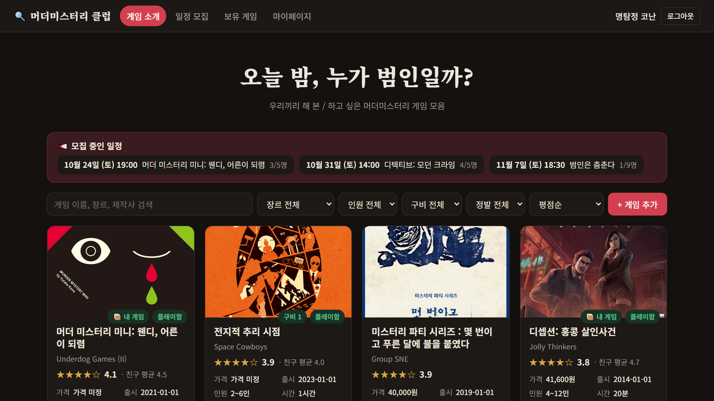
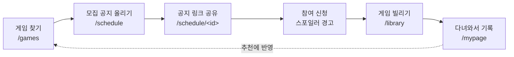
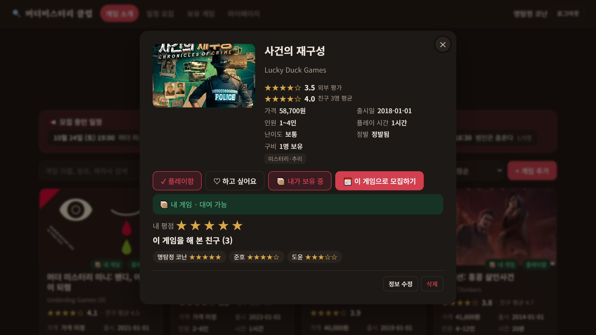
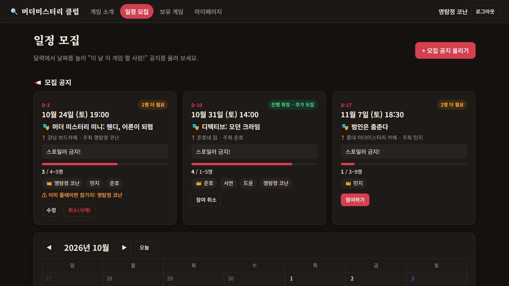
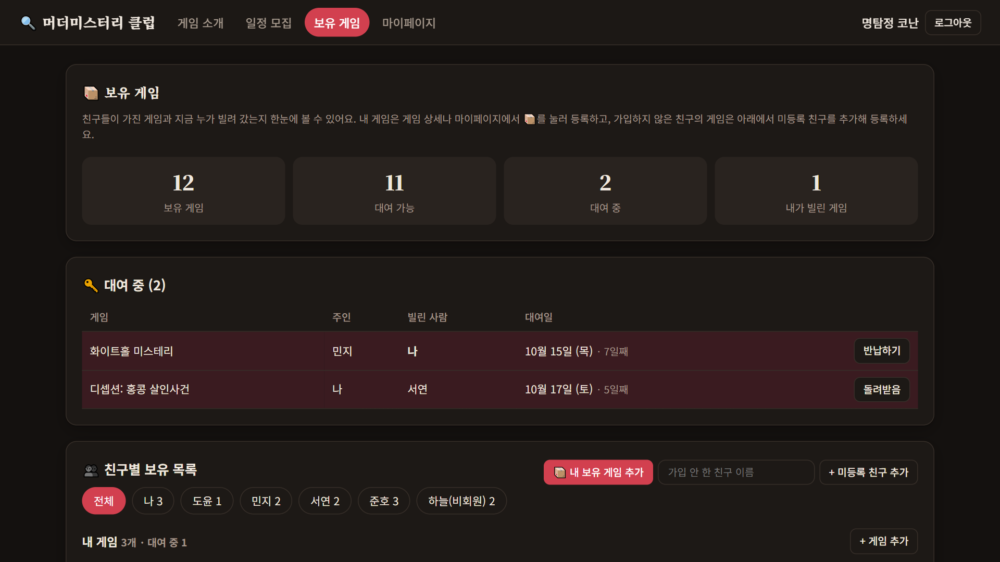
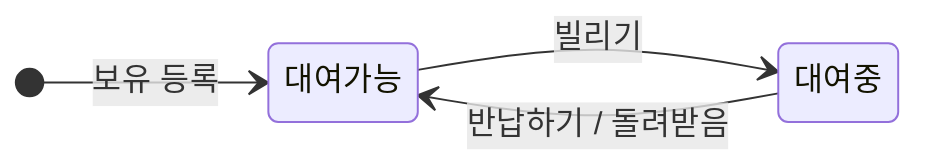
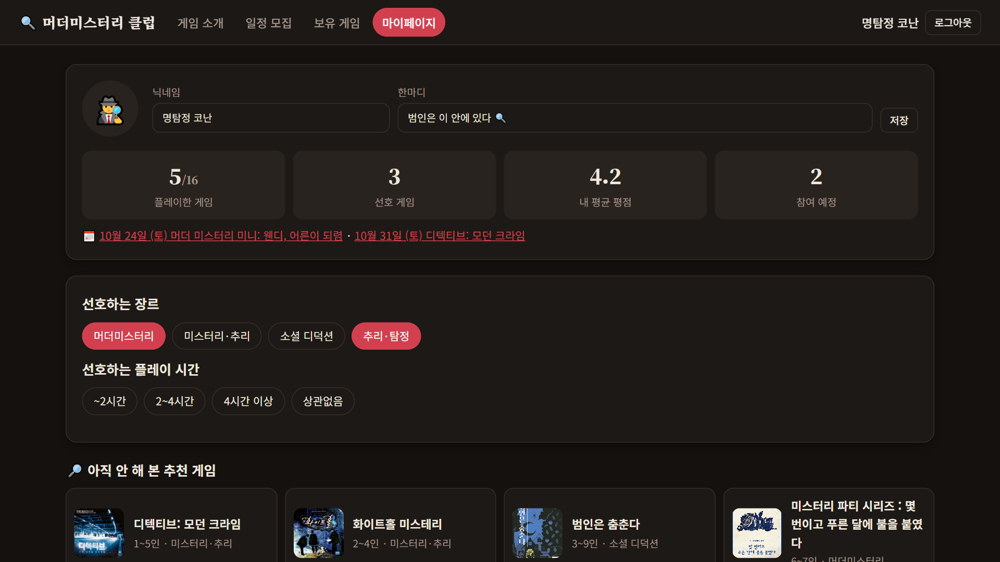
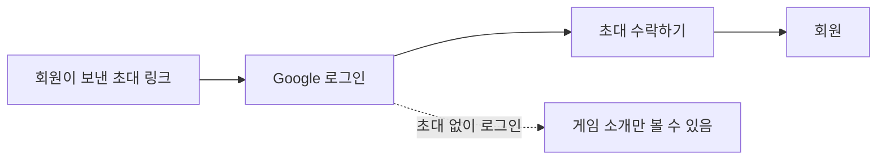

# 🕵️ 머더미스터리 클럽

친구들끼리 해 본 머더미스터리 게임과 하고 싶은 게임을 모으고, 모임 일정을 잡고, 서로의 게임을 빌려 주는 초대제 사이트입니다.

**사이트:** https://mahamuder.web.app



## 모임 한 번이 흘러가는 길



## 화면별 기능

### 📚 게임 소개 `/games`

로그인하지 않아도 볼 수 있습니다. 위의 첫 스크린샷이 이 화면입니다.

- **모집 중인 일정**: 다가오는 모임이 맨 위에 보이고, 누르면 공지로 이동합니다.
- **검색·필터·정렬**: 이름·장르·제작사로 검색하고, 장르·인원·구비·정발 여부로 거르고, 평점순·최신순·가격순·친구 플레이순으로 정렬합니다.
- **게임 추가**: 회원은 누구나 새 게임을 등록할 수 있습니다.
- **카드 배지**: 내 게임, 플레이함, 구비 수가 표지 위에 붙고, 별점 옆에 친구 평균이 함께 보입니다.

### 🔍 게임 상세 `/games/<id>`

게임마다 주소가 있어서 링크를 보내면 이 창이 바로 열립니다.



- 외부 평가와 친구 평균 평점, 클럽 안에서 몇 명이 가지고 있는지
- **플레이함 · 하고 싶어요 · 보유** 버튼으로 내 기록 남기기, 별 다섯 개로 내 평점 매기기
- **이 게임으로 모집하기**로 바로 모집 공지 작성
- 대여 상태: 내 게임인지, 지금 빌릴 수 있는지, 누가 빌려 갔는지
- 이 게임을 해 본 친구와 각자의 평점
- 정보 수정은 회원 누구나, 삭제는 등록한 사람만 (플레이 기록·보유자·모집 공지가 걸린 게임은 삭제 불가)

### 📅 일정 모집 `/schedule`

달력에서 날짜를 눌러 "이 날 이 게임 할 사람!" 공지를 올립니다.



- 공지마다 D-day, 날짜·시간, 게임, 장소, 주최자, 메모(준비물·회비 등)
- 모집 상태: "N명 더 필요", 최소 인원을 넘으면 "진행 확정 · 추가 모집", 꽉 차면 "모집 완료"
- 인원 막대와 참가자 목록 (👑는 주최자)
- **스포일러 경고**: 이미 해 본 게임에 참여하려 하면 한 번 더 묻고, 공지에도 이미 해 본 참가자를 표시합니다.
- 참여하기·참여 취소는 자기 자신만, 수정·삭제는 주최자만
- 공지마다 `/schedule/<id>` 공유 링크가 있어 카톡방에 붙여 넣으면 그 공지가 바로 열립니다.
- 지난 모임에서 **플레이 했어요**를 누르면 모임 날짜로 내 플레이 기록이 남습니다.

### 📦 보유 게임과 대여 `/library`

누가 어떤 게임을 가졌고 지금 누가 빌려 갔는지 한눈에 봅니다.



- 요약: 보유 게임 · 대여 가능 · 대여 중 · 내가 빌린 게임 수
- 대여 중 목록: 게임, 주인, 빌린 사람, 대여일과 며칠째인지. 빌린 사람은 **반납하기**, 주인은 **돌려받음**
- **내 보유 게임 추가**: 검색으로 가진 게임을 골라 등록
- **미등록 친구 추가**: 가입하지 않은 친구의 게임도 등록해 빌릴 수 있게 함
- 친구별 보유 목록을 사람마다 걸러 보기



같은 게임을 여러 명이 가지고 있으면 한 벌씩 따로 빌립니다.

### 🕵️ 마이페이지 · 탐정 수첩 `/mypage`

내 기록과 취향을 모아 두면 아직 안 해 본 게임을 골라 추천해 줍니다.



- 닉네임(사이트 전체에서 Google 이름 대신 표시)과 한마디
- 플레이한 게임 수, 선호 게임, 내 평균 평점, 참여 예정 모임
- 선호하는 장르와 플레이 시간(~2시간 · 2~4시간 · 4시간 이상 · 상관없음)
- 🔎 아직 안 해 본 추천 게임
- **친구 초대 링크 복사**

## 초대와 가입 `/join/<코드>`

Google 로그인만으로는 아무것도 볼 수 없고, 회원이 보낸 초대 링크로 들어와야 클럽에 가입됩니다.



- 로그인 창을 거쳐도 초대 코드를 기억해 둡니다.
- 초대 코드는 Firebase 콘솔의 `config/invite` 문서 `code` 필드에서 관리합니다. 이 문서가 없으면 새 회원이 가입할 수 없고, 코드를 바꾸면 예전 링크는 더 이상 쓸 수 없습니다.

## 누가 무엇을 할 수 있나

화면이 아니라 Firestore 보안 규칙(`firestore.rules`)이 직접 막습니다.

| 기능 | 비회원 | 회원 | 조건 |
| --- | :---: | --- | --- |
| 게임 소개 보기 | ✅ | ✅ | 검색 노출용 |
| 게임 추가·수정 | ❌ | ✅ | 링크·표지는 http(s) 주소만 |
| 게임 삭제 | ❌ | 등록한 사람만 | 기록·보유자·공지가 있으면 불가 |
| 프로필·플레이 기록 | ❌ | 보기는 전체, 수정은 본인만 | |
| 일정 공지 | ❌ | 주최자는 전체, 그 외는 본인 참여만 | |
| 대여·반납 | ❌ | ✅ | 한 번에 한 벌씩 |
| 미등록 친구 관리 | ❌ | ✅ | 게임 보유자로만 사용 |

개인 기록(플레이·대여 등)은 검색 엔진용 정적 페이지나 구조화 데이터에 넣지 않습니다.

## 개발

React 18, TypeScript, Vite, Firebase(Hosting, Firestore, Google 로그인)로 만들었습니다. 배포는 `react-ts` 브랜치에서 합니다.

```bash
npm install
npm run dev:demo     # 데모 모드(localStorage). 실제 데이터 없이 로그인·쓰기 기능 확인
npm run dev          # 실제 Firestore에 연결
npm run typecheck
firebase deploy --only hosting     # 빌드 포함
firebase deploy --only firestore   # 보안 규칙 (hosting 다음에 배포)
```

자세한 구조와 주의할 점은 [CLAUDE.md](CLAUDE.md)에 있습니다. 화면별 설명을 담은 HTML 문서는 [feature-overview.html](feature-overview.html), [feature-guide.html](feature-guide.html)입니다.

> 스크린샷은 데모 데이터로 찍은 화면입니다.
