# 🕵️ 머더미스터리 클럽

친구들끼리 해 본 머더미스터리 게임과 하고 싶은 게임을 모으고, 모임 일정을 잡고, 서로의 게임을 빌려 주는 초대제 사이트입니다.

**사이트:** https://mahamuder.web.app

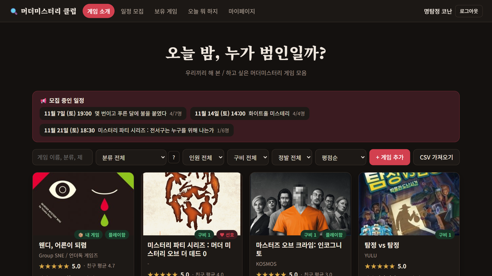

## 모임 한 번이 흘러가는 길

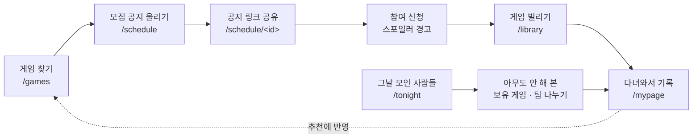

미리 잡은 모임이 아니어도, 모인 사람만 고르면 **오늘 뭐 하지**가 다 같이 처음 해 보는 게임을 찾아 줍니다.

## 화면별 기능

### 📚 게임 소개 `/games`

로그인하지 않아도 볼 수 있습니다. 위의 첫 스크린샷이 이 화면입니다.

- **모집 중인 일정**: 다가오는 모임이 맨 위에 보이고, 누르면 공지로 이동합니다.
- **분류**: 게임마다 머더미스터리(역할극)·추리(협력 추리)·소셜 디덕션(마피아류) 중 하나가 붙습니다. 배경·세계관 태그는 스포일러가 될 수 있어서 보여 주지 않고, 분류 옆 **?** 버튼으로 세 분류의 뜻을 볼 수 있습니다.
- **검색·필터·정렬**: 이름·분류·제작사로 검색하고, 분류·인원·구비·정발 여부로 거르고, 평점순·최신순·가격순·친구 플레이순·이름순으로 정렬합니다. 인원 필터에는 "10명 이상"과, 인원 정보가 없는 게임만 모아 보는 "인원 미정"이 있습니다.
- **게임 추가 · CSV 가져오기**: 회원은 누구나 새 게임을 등록할 수 있고, 게임 목록 CSV에서 사이트에 없는 게임만 골라 한꺼번에 등록할 수도 있습니다.
- **카드 배지**: 내 게임, 플레이함, 선호, 구비 수가 표지 위에 붙고, 별점 옆에 친구 평균이 함께 보입니다.

### 🔍 게임 상세 `/games/<id>`

게임마다 주소가 있어서 링크를 보내면 이 창이 바로 열립니다.

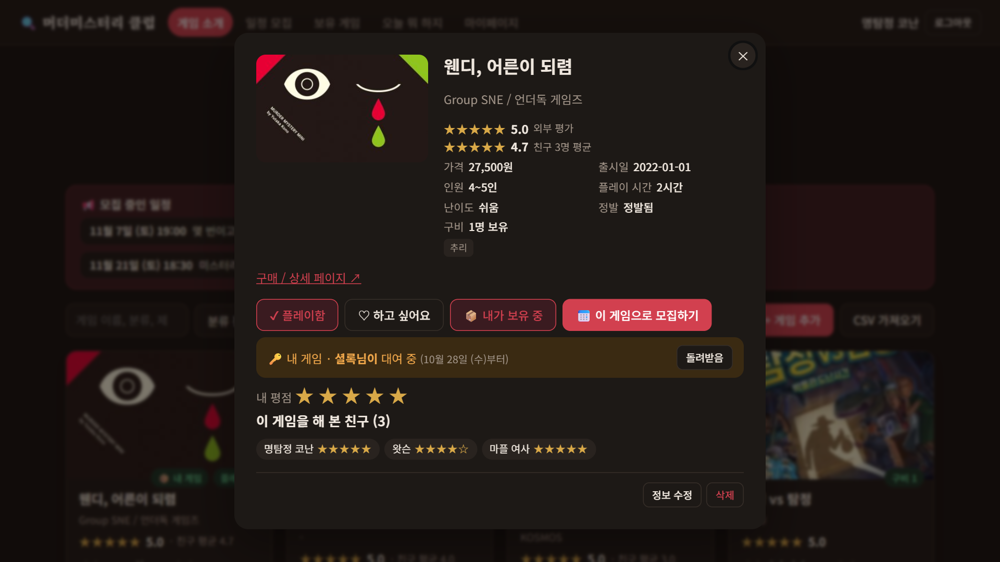

- 외부 평가와 친구 평균 평점, 분류, 클럽 안에서 몇 명이 가지고 있는지
- **플레이함 · 하고 싶어요 · 보유** 버튼으로 내 기록 남기기, 별 다섯 개로 내 평점 매기기
- **이 게임으로 모집하기**로 바로 모집 공지 작성
- 대여 상태: 내 게임인지, 지금 빌릴 수 있는지, 누가 빌려 갔는지
- 이 게임을 해 본 친구와 각자의 평점
- 정보 수정은 회원 누구나, 삭제는 등록한 사람만 (플레이 기록·보유자·모집 공지가 걸린 게임은 삭제 불가)

### 📅 일정 모집 `/schedule`

달력에서 날짜를 눌러 "이 날 이 게임 할 사람!" 공지를 올립니다.

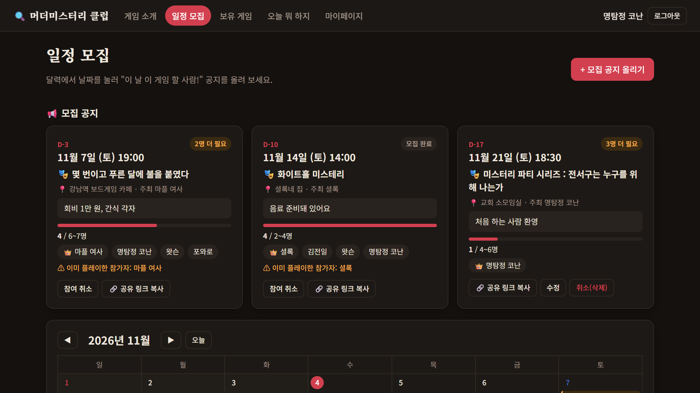

- 공지마다 D-day, 날짜·시간, 게임, 장소, 주최자, 메모(준비물·회비 등)
- 공지를 쓸 때 게임은 표지 격자에서 고릅니다. 탭(보유 게임: 회원·미등록 친구 누군가 가진 게임 · 내 게임 · 전체)과 이름·분류·제작사 검색으로 찾고, 고른 뒤에는 작은 표지로 접혀 보입니다.
- 모집 상태: "N명 더 필요", 최소 인원을 넘으면 "진행 확정 · 추가 모집", 꽉 차면 "모집 완료"
- 인원 막대와 참가자 목록 (👑는 주최자)
- **스포일러 경고**: 이미 해 본 게임에 참여하려 하면 한 번 더 묻고, 공지에도 이미 해 본 참가자를 표시합니다.
- 참여하기·참여 취소는 자기 자신만, 수정·삭제는 주최자만
- 공지마다 `/schedule/<id>` 공유 링크가 있어 카톡방에 붙여 넣으면 그 공지가 바로 열립니다.
- 지난 모임에서 **플레이 했어요**를 누르면 모임 날짜로 내 플레이 기록이 남습니다.

### 📦 보유 게임과 대여 `/library`

누가 어떤 게임을 가졌고 지금 누가 빌려 갔는지 한눈에 봅니다.

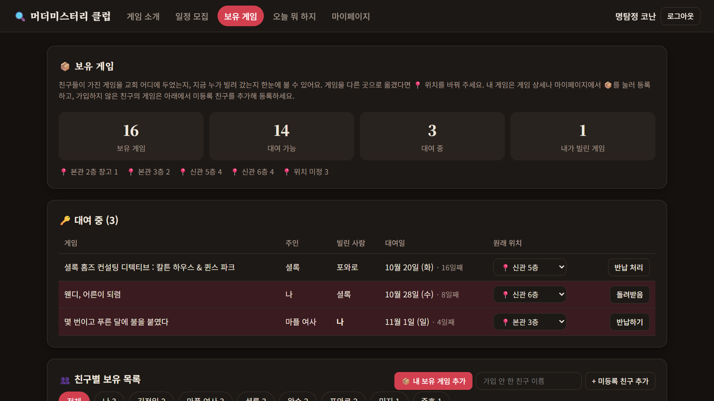

- 요약: 보유 게임 · 대여 가능 · 대여 중 · 내가 빌린 게임 수
- 대여 중 목록: 게임, 주인, 빌린 사람, 대여일과 며칠째인지. 빌린 사람은 **반납하기**, 주인은 **돌려받음**
- **내 보유 게임 추가**: 검색으로 가진 게임을 골라 등록
- **미등록 친구 추가**: 가입하지 않은 친구의 게임도 등록해 빌릴 수 있게 함
- 친구별 보유 목록을 사람마다 걸러 보기

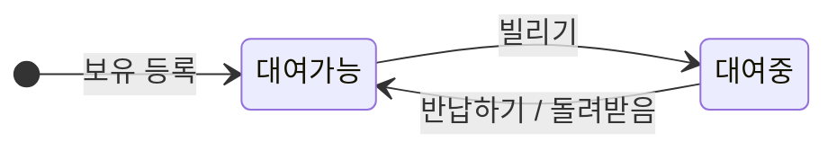

같은 게임을 여러 명이 가지고 있으면 한 벌씩 따로 빌립니다.

### 🎲 오늘 뭐 하지 `/tonight`

그날 모인 사람을 고르면, 가진 게임 중 고른 회원 누구도 해 보지 않은 게임을 보여 줍니다.

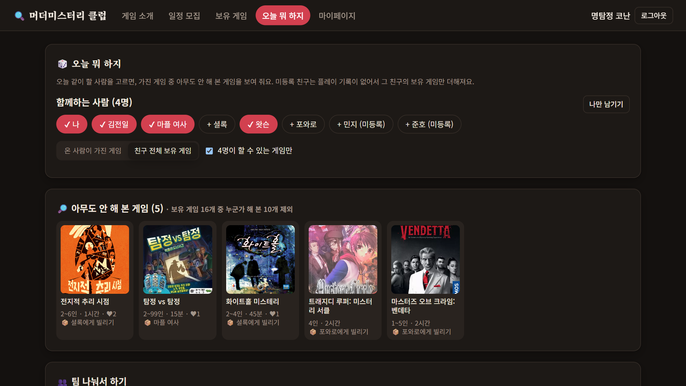

- 함께하는 사람은 회원과 미등록 친구 중에서 고릅니다. 미등록 친구는 플레이 기록이 없어서 그 친구가 가진 게임만 더해집니다.
- 찾는 범위: **온 사람이 가진 게임** 또는 **친구 전체 보유 게임**(빌려 올 수 있는 게임까지)
- **N명이 할 수 있는 게임만**: 지금 인원으로 할 수 있는 게임만 남깁니다. 인원 정보가 없는 게임은 빠집니다.
- 게임마다 누가 가지고 있는지(📦), 온 사람 중 몇 명이 하고 싶어 하는지(♥)가 보입니다.

4명 이상이면 **팀 나눠서 하기**가 나옵니다. 2팀이나 3팀으로 나눠 팀마다 팀원 아무도 안 해 본 게임을 하나씩 하는 경우를 모두 찾아, 고를 수 있는 게임이 많고 인원이 고른 나누기부터 보여 줍니다.

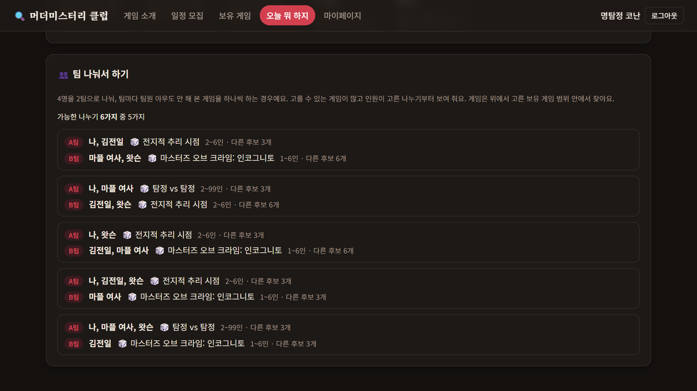

### 🕵️ 마이페이지 · 탐정 수첩 `/mypage`

내 기록과 취향을 모아 두고, 아직 안 해 본 게임과 친구들의 기록을 봅니다.

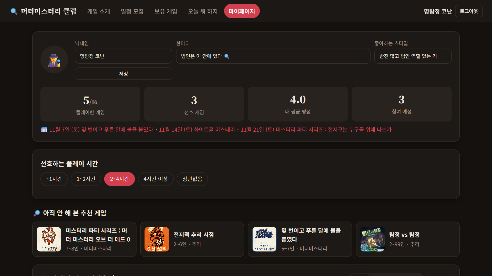

- 닉네임(사이트 전체에서 Google 이름 대신 표시), 한마디, **좋아하는 스타일**(자유 입력, 예: "반전 많고 범인 역할 있는 거")
- 플레이한 게임 수, 선호 게임, 내 평균 평점, 참여 예정 모임. 플레이한 게임·선호 게임 숫자를 누르면 그 목록이 표지로 열립니다.
- 선호하는 플레이 시간(~1시간 · 1~2시간 · 2~4시간 · 4시간 이상 · 상관없음)
- 🔎 아직 안 해 본 추천 게임: 내가 선호 표시했거나 4점 이상 준 게임과 같은 분류를 먼저 추천합니다.

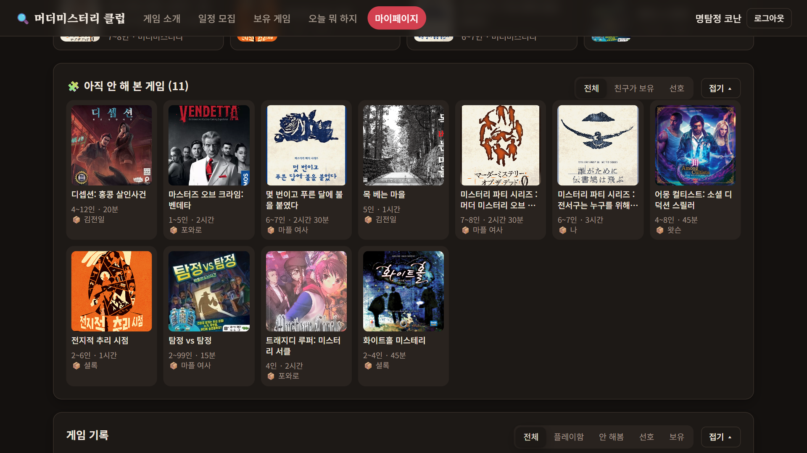

- 🧩 **아직 안 해 본 게임**: 표지 격자로 보여 주고(24개씩 더 보기), 전체 · 친구가 보유(우리 중 누가 가지고 있어 바로 할 수 있는 게임) · 선호로 거릅니다. 접어 둘 수 있고 접힘 상태는 기억됩니다.
- **게임 기록**: 전체 · 플레이함 · 안 해봄 · 선호 · 보유 탭에서 플레이 여부, 별점, 보유(📦), 선호(♡)를 한 줄씩 바로 고칩니다.
- **친구들의 기록**: 친구마다 플레이·위시리스트·보유 개수, 좋아하는 스타일, 한마디. 이름이나 개수를 누르면 아래 창이 열립니다.
- **친구 초대 링크 복사**

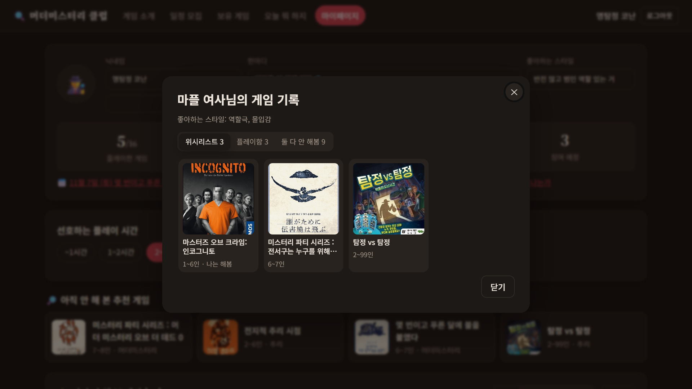

친구 게임 기록 창은 위시리스트(♡ 하고 싶어요) · 플레이함 · **둘 다 안 해봄**(나와 그 친구 모두 안 해 본 게임) 탭으로, 같이 할 게임을 고를 때 씁니다. 내가 이미 해 본 게임에는 "나는 해봄"이 붙습니다.

## 초대와 가입 `/join/<코드>`

Google 로그인만으로는 아무것도 볼 수 없고, 회원이 보낸 초대 링크로 들어와야 클럽에 가입됩니다.

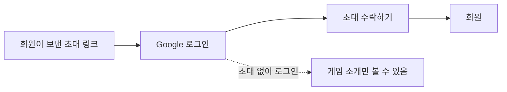

- 로그인 창을 거쳐도 초대 코드를 기억해 둡니다.
- 초대 코드는 Firebase 콘솔의 `config/invite` 문서 `code` 필드에서 관리합니다. 이 문서가 없으면 새 회원이 가입할 수 없고, 코드를 바꾸면 예전 링크는 더 이상 쓸 수 없습니다.

## 누가 무엇을 할 수 있나

화면이 아니라 Firestore 보안 규칙(`firestore.rules`)이 직접 막습니다.

| 기능 | 비회원 | 회원 | 조건 |
| --- | :---: | --- | --- |
| 게임 소개 보기 | ✅ | ✅ | 검색 노출용 |
| 게임 추가·수정 | ❌ | ✅ | 링크·표지는 http(s) 주소만 |
| 게임 삭제 | ❌ | 등록한 사람만 | 기록·보유자·공지가 있으면 불가 |
| 프로필·플레이 기록 | ❌ | 보기는 전체, 수정은 본인만 | |
| 일정 공지 | ❌ | 주최자는 전체, 그 외는 본인 참여만 | |
| 대여·반납 | ❌ | ✅ | 한 번에 한 벌씩 |
| 미등록 친구 관리 | ❌ | ✅ | 게임 보유자로만 사용 |

개인 기록(플레이·대여 등)은 검색 엔진용 정적 페이지나 구조화 데이터에 넣지 않습니다.

## 개발

React 18, TypeScript, Vite, Firebase(Hosting, Firestore, Google 로그인)로 만들었습니다. 배포는 `main` 브랜치에서 합니다.

```bash
npm install
npm run dev:demo     # 데모 모드(localStorage). 실제 데이터 없이 로그인·쓰기 기능 확인
npm run dev          # 실제 Firestore에 연결
npm run typecheck
firebase deploy --only hosting     # 빌드 포함
firebase deploy --only firestore   # 보안 규칙 (hosting 다음에 배포)
```

자세한 구조와 주의할 점은 [CLAUDE.md](CLAUDE.md)에 있습니다. 화면별 설명을 담은 HTML 문서는 [feature-overview.html](feature-overview.html), [feature-guide.html](feature-guide.html)입니다.

> 스크린샷은 데모 데이터로 찍은 화면입니다.
